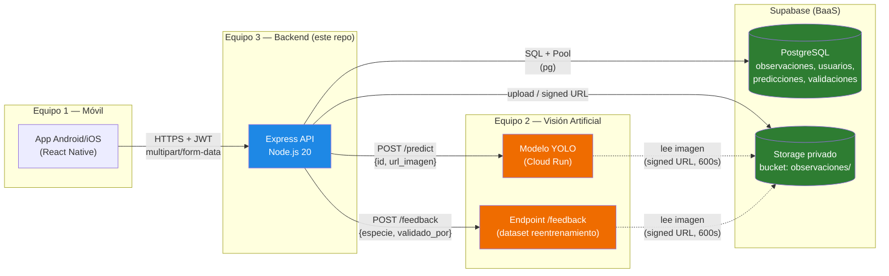
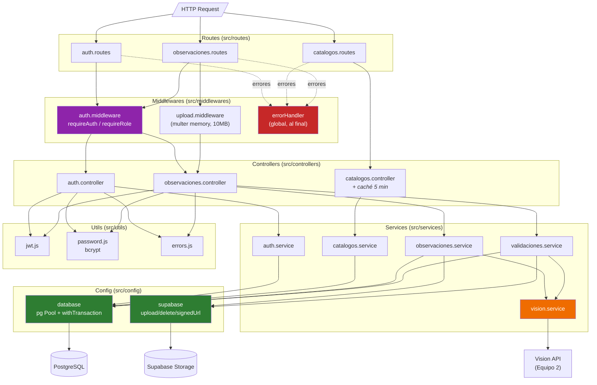
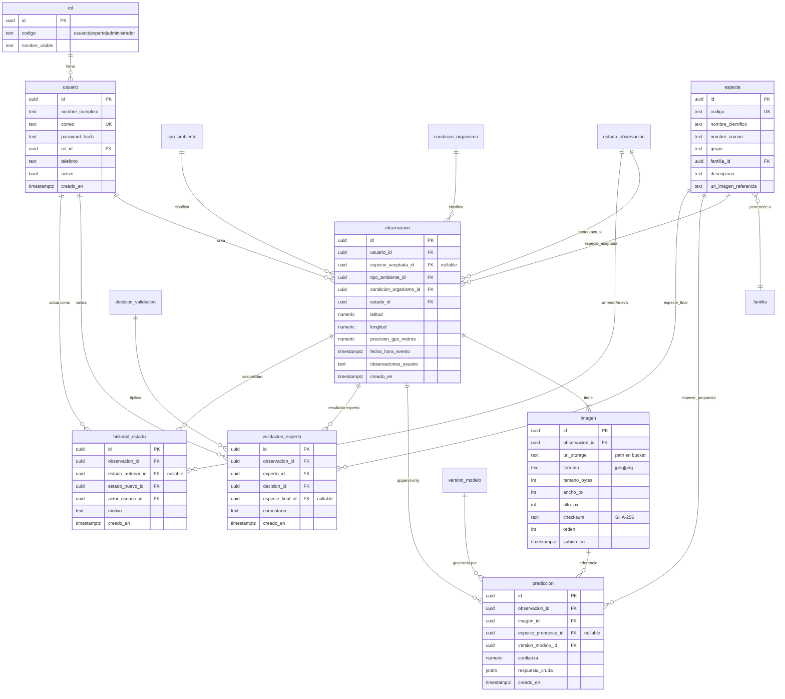
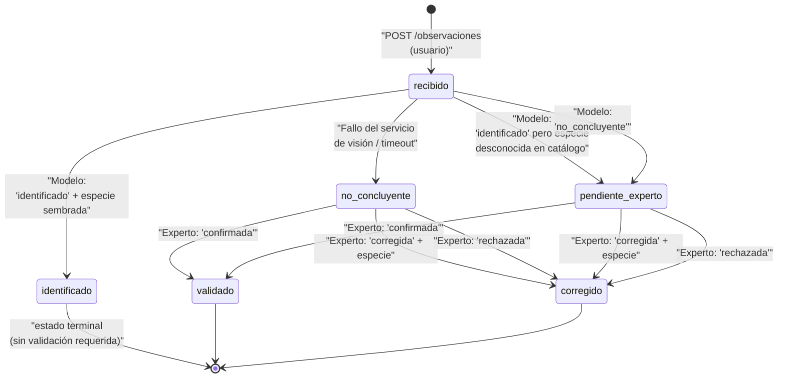
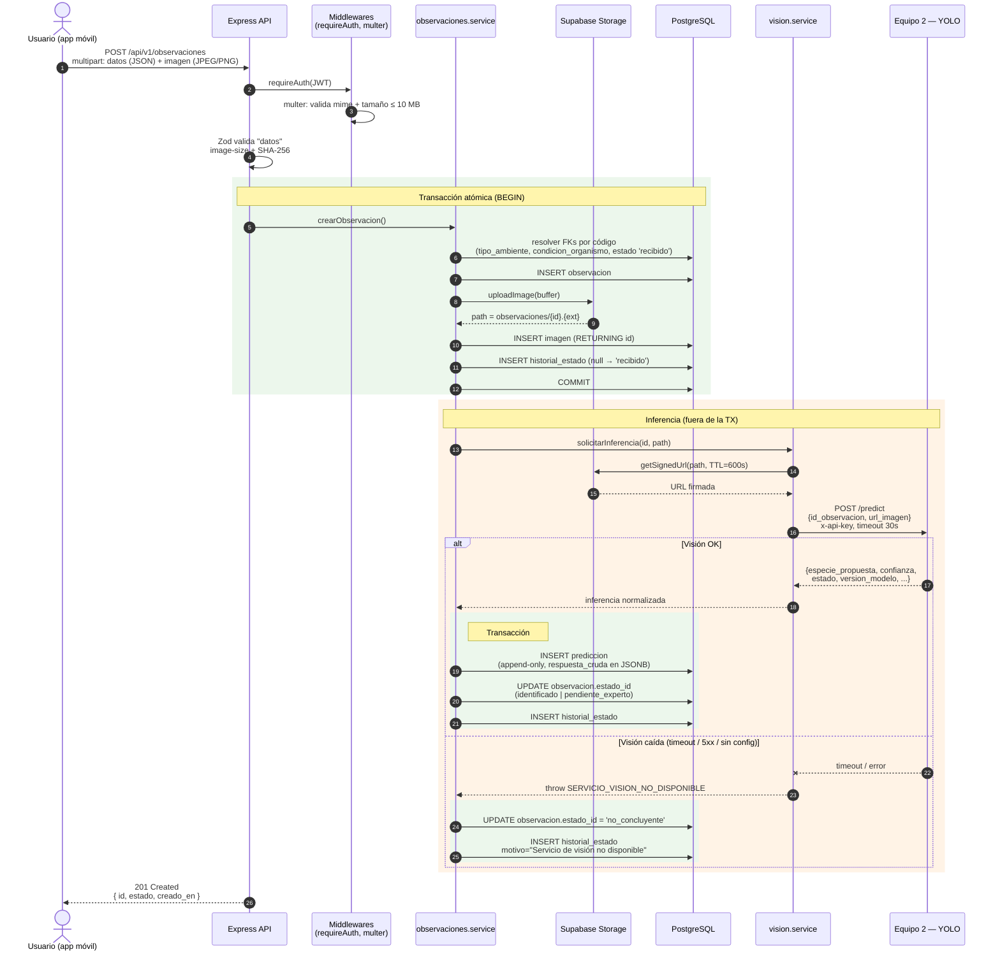
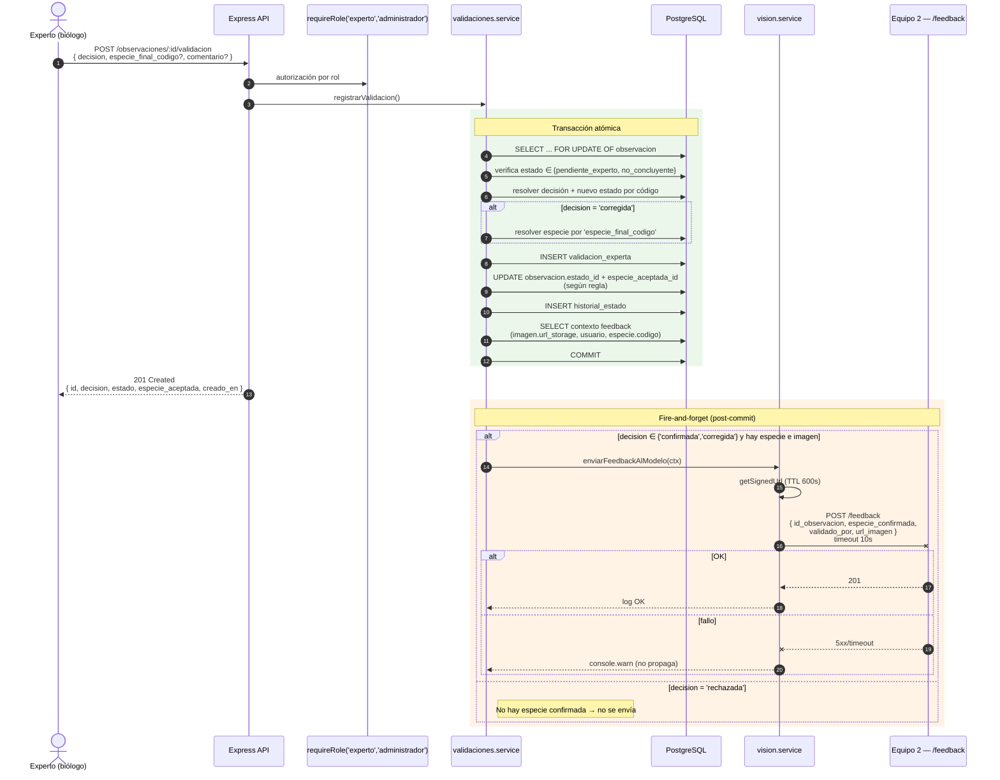
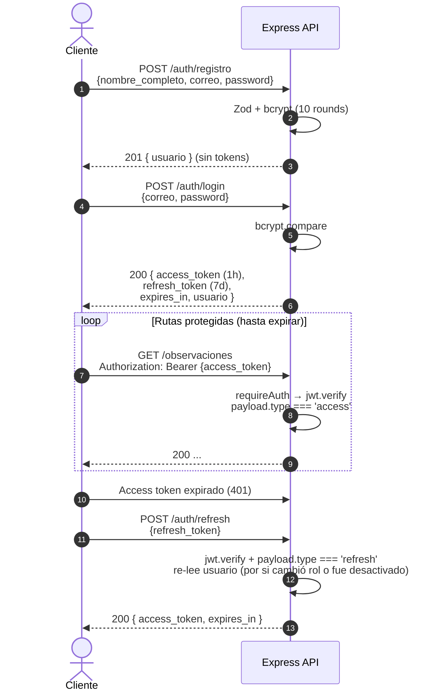
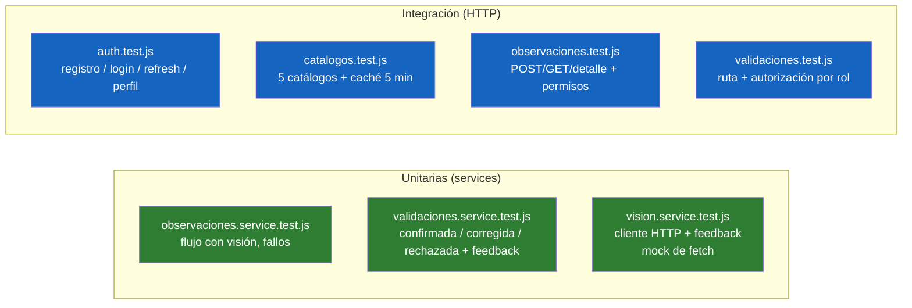

# IdentiMar — Backend

Backend oficial de **IdentiMar**, plataforma de ciencia ciudadana para registrar y validar observaciones de **rayas** en el **Urabá antioqueño** (Colombia). Entregable del **Equipo 3** del Proyecto Integrador I — Universidad de Antioquia.

El sistema recibe fotos y metadata desde la app móvil (Equipo 1), las pasa por un modelo YOLO (Equipo 2) y las entrega a expertos biólogos para validación, construyendo así un dataset con retroalimentación al modelo.

---

## Índice

- [1. Stack y decisiones de diseño](#1-stack-y-decisiones-de-diseño)
- [2. Arquitectura del sistema](#2-arquitectura-del-sistema)
- [3. Arquitectura interna del backend](#3-arquitectura-interna-del-backend)
- [4. Modelo de datos](#4-modelo-de-datos)
- [5. Máquina de estados de una observación](#5-máquina-de-estados-de-una-observación)
- [6. Flujo end-to-end: creación de observación + inferencia](#6-flujo-end-to-end-creación-de-observación--inferencia)
- [7. Flujo end-to-end: validación experta + feedback al modelo](#7-flujo-end-to-end-validación-experta--feedback-al-modelo)
- [8. Autenticación y autorización](#8-autenticación-y-autorización)
- [9. API REST — referencia resumida](#9-api-rest--referencia-resumida)
- [10. Variables de entorno](#10-variables-de-entorno)
- [11. Puesta en marcha local](#11-puesta-en-marcha-local)
- [12. Testing](#12-testing)
- [13. Estructura del proyecto](#13-estructura-del-proyecto)
- [14. Despliegue](#14-despliegue)

---

## 1. Stack y decisiones de diseño

| Capa | Tecnología | Por qué |
|---|---|---|
| Runtime | **Node.js ≥ 20** | `fetch` y `AbortSignal.timeout` nativos para integrar al servicio de visión. |
| HTTP | **Express 4** | Minimalismo + middlewares bien probados. |
| Base de datos | **PostgreSQL** (Supabase) | ACID, UUIDs nativos, JSONB para `respuesta_cruda` del modelo. |
| Driver | **pg** (`Pool` + transacciones) | Control fino sobre `BEGIN/COMMIT/ROLLBACK` para operaciones multi-tabla. |
| Storage | **Supabase Storage** | Bucket privado para imágenes + URLs firmadas (TTL). |
| Auth | **JWT** (`jsonwebtoken`) + **bcryptjs** | Access/refresh tokens; hash de contraseña con 10 salt rounds. |
| Validación | **Zod** | Esquemas declarativos; traduce errores a `ValidacionError`. |
| Uploads | **Multer** (memoryStorage) | JPEG/PNG hasta 10 MB sin tocar el disco. |
| Tests | **Jest + Supertest** | 7 suites: unit (servicios) + integración (HTTP). |

**Principios de diseño:**

- **Capas desacopladas**: `routes → middlewares → controllers → services → config`. El controller valida input y da forma a la respuesta; el service manda SQL y gestiona transacciones.
- **Fire-and-forget para IA**: la inferencia del modelo YOLO ocurre **fuera** de la transacción de creación. Un `fetch` de 30 s dentro de una transacción abierta bloquearía una conexión del pool.
- **Append-only**: `prediccion` nunca se actualiza; cada nueva corrida es una fila nueva. Esto preserva el historial completo del modelo.
- **Compensación en Storage**: si el upload a Supabase tiene éxito pero la transacción en BD falla, se dispara `deleteImage(path)` para no dejar archivos huérfanos.
- **Errores en español, códigos estables**: `VALIDACION`, `NO_AUTENTICADO`, `SIN_PERMISO`, `NO_ENCONTRADO`, `CONFLICTO`, `ERROR_INTERNO`.

---

## 2. Arquitectura del sistema

Vista macro de los tres equipos del proyecto y los sistemas externos.



**Responsabilidades:**

- **App móvil** sube foto + metadata y consulta estado de sus observaciones.
- **Backend** es la única fuente de verdad: autentica, autoriza, orquesta Storage + BD + Visión, y expone la máquina de estados.
- **Visión** inferirá la especie y, cuando el experto valide, recibirá el feedback para ampliar su dataset.

---

## 3. Arquitectura interna del backend

Separación en capas y dependencias entre módulos.



**Convenciones:**

- Cada ruta async envuelve su handler en `wrap(fn)` para que los errores lanzados caigan en el `errorHandler` global sin `try/catch` por handler.
- Los **services** nunca hablan HTTP; devuelven objetos planos o lanzan `ApiError`.
- La **integración con visión** es un service aparte (`vision.service.js`) para poder mockearlo en tests.

---

## 4. Modelo de datos

Esquema relacional en PostgreSQL (Supabase). Los nombres de códigos (`'usuario'`, `'experto'`, `'recibido'`, `'identificado'`, …) son **sembrados** y se usan desde el backend por su `codigo`, no por su `id`.



**Invariantes importantes:**

- `prediccion` es **append-only** — nunca se hace `UPDATE`; cada corrida del modelo es una fila nueva.
- `historial_estado` registra **toda** transición de estado (incluida la inicial `null → recibido`).
- `especie_aceptada_id` de `observacion` solo cambia cuando: (a) el modelo identifica con alta confianza, o (b) un experto corrige/rechaza.

---

## 5. Máquina de estados de una observación

Toda transición queda registrada en `historial_estado`.



**Reglas aplicadas por el backend (`observaciones.service.js` + `validaciones.service.js`):**

| Transición | Condición | Qué pasa con `especie_aceptada_id` |
|---|---|---|
| `recibido → identificado` | Modelo devuelve `estado='identificado'` y la especie **existe** en catálogo | Se **fija** a la especie del modelo |
| `recibido → pendiente_experto` | Modelo devuelve `estado='identificado'` pero especie **desconocida**, o `estado='no_concluyente'` | **Sin cambios** (predicción guardada con `especie_propuesta_id = NULL`) |
| `recibido → no_concluyente` | Timeout / 5xx / config faltante del servicio de visión | **Sin cambios**. Motivo registrado: `"Servicio de visión no disponible"` |
| `(pendiente_experto\|no_concluyente) → validado` | Experto `confirmada` | **Sin cambios** (confirma la propuesta vigente) |
| `(pendiente_experto\|no_concluyente) → corregido` | Experto `corregida` + `especie_final_codigo` | Se **reemplaza** por la especie del experto |
| `(pendiente_experto\|no_concluyente) → corregido` | Experto `rechazada` | Se pone a **`NULL`** |

---

## 6. Flujo end-to-end: creación de observación + inferencia

Secuencia completa cuando un usuario sube una foto. Nótese que la inferencia corre **fuera** de la transacción de creación para no bloquear conexiones del pool.



**Puntos clave:**

- Si el upload a Storage **tuvo éxito** pero el `INSERT imagen` falla → el `catch` externo dispara `supabase.deleteImage(path)` (compensación).
- Si la **inferencia** falla, la observación **ya existe**: no se propaga el error al cliente; el usuario ve `estado: "no_concluyente"` y un experto la revisará.
- El servicio de visión recibe una **URL firmada con TTL de 600 s** — no se expone el bucket.

---

## 7. Flujo end-to-end: validación experta + feedback al modelo

Cuando un experto registra su decisión, el backend aplica la máquina de estados y, en segundo plano, le pasa al Equipo 2 el ejemplo etiquetado para reentrenamiento.



**Reglas de feedback (`DECISIONES_CON_FEEDBACK`):**

| Decisión | Enviar feedback | Razón |
|---|---|---|
| `confirmada` | ✅ Sí | La predicción del modelo fue correcta → refuerza etiquetado |
| `corregida` | ✅ Sí | El modelo erró, pero el experto da la etiqueta correcta → ejemplo de alto valor |
| `rechazada` | ❌ No | No hay especie confirmada que enviar |

El feedback es **best-effort**: si el endpoint del Equipo 2 falla, queda en `console.warn` y la validación responde `201` igual.

---

## 8. Autenticación y autorización

### Flujo de tokens



### Matriz de permisos

Los roles vienen del catálogo `rol` por su `codigo`. El JWT lleva `rol` en el payload.

| Ruta | `No auth` | `usuario` | `experto` | `administrador` |
|---|:-:|:-:|:-:|:-:|
| `GET /health` | ✅ | ✅ | ✅ | ✅ |
| `POST /auth/registro` | ✅ | ✅ | ✅ | ✅ |
| `POST /auth/login` | ✅ | ✅ | ✅ | ✅ |
| `POST /auth/refresh` | ✅ | ✅ | ✅ | ✅ |
| `GET /auth/perfil` | ❌ | ✅ | ✅ | ✅ |
| `GET /catalogos/*` | ✅ | ✅ | ✅ | ✅ |
| `POST /observaciones` | ❌ | ✅ | ✅ | ✅ |
| `GET /observaciones` (ve solo las propias) | ❌ | ✅ | ✅ | ✅ *(ve todas)* |
| `GET /observaciones/:id` (si es autor) | ❌ | ✅ | ✅ *(cualquiera)* | ✅ *(cualquiera)* |
| `GET /observaciones/pendientes` | ❌ | ❌ | ✅ | ✅ |
| `POST /observaciones/:id/validacion` | ❌ | ❌ | ✅ | ✅ |

> El registro siempre crea con rol `usuario`. Para elevar a `experto` o `administrador` se cambia manualmente en la BD (ver [postman/README.md](postman/README.md)).

---

## 9. API REST — referencia resumida

Prefijo base: **`/api/v1`**. Las respuestas de error siguen el mismo formato:

```json
{ "error": { "codigo": "VALIDACION", "mensaje": "...", "detalles": [...] } }
```

**Documentación interactiva (OpenAPI 3.0):**

- Producción: <https://identimar-backend.onrender.com/api/docs>
- Spec cruda: <https://identimar-backend.onrender.com/api/docs.json>
- Local:      <http://localhost:3000/api/docs>

En la UI, el botón **Authorize** acepta el `access_token` recibido en `/auth/login` para probar endpoints protegidos.

### Salud

| Método | Ruta | Descripción |
|---|---|---|
| GET | `/health` | `{ "status": "ok" }` |

### Autenticación (`/api/v1/auth`)

| Método | Ruta | Descripción |
|---|---|---|
| POST | `/registro` | Crea un usuario con rol `usuario`. No devuelve tokens. |
| POST | `/login` | Devuelve `access_token`, `refresh_token`, `expires_in`, `usuario`. |
| POST | `/refresh` | Intercambia un `refresh_token` por un nuevo `access_token`. |
| GET | `/perfil` | 🔒 Devuelve el usuario autenticado. |

### Catálogos (`/api/v1/catalogos`) — caché 5 min en memoria

| Método | Ruta | Devuelve |
|---|---|---|
| GET | `/especies` | Especies con familia embebida. |
| GET | `/familias` | Familias taxonómicas. |
| GET | `/tipos-ambiente` | Códigos para el formulario de la app. |
| GET | `/condiciones-organismo` | Códigos para el formulario de la app. |
| GET | `/estados` | Estados con `orden` y `es_terminal`. |

### Observaciones (`/api/v1/observaciones`)

| Método | Ruta | Auth | Descripción |
|---|---|---|---|
| POST | `/` | 🔒 usuario+ | `multipart/form-data`: campo `datos` (JSON) + `imagen` (JPEG/PNG, ≤10 MB). Lanza inferencia asíncrona. |
| GET | `/` | 🔒 usuario+ | Lista paginada. Un `administrador` ve todas; otros, solo las suyas. Query: `estado`, `pagina`, `tamano`. |
| GET | `/pendientes` | 🔒 experto+ | Cola de validación (`pendiente_experto` ∪ `no_concluyente`), ordenada por `creado_en ASC`. |
| GET | `/:id` | 🔒 autor o experto+ | Detalle completo: observación + imagen (URL firmada 1h) + predicción + validación + historial. |
| POST | `/:id/validacion` | 🔒 experto+ | Registra decisión. Body: `{ decision, especie_final_codigo?, comentario? }`. |

### Ejemplos de payload

**POST `/observaciones` → campo `datos`:**

```json
{
  "latitud": 8.6234,
  "longitud": -76.7311,
  "fecha_hora_evento": "2026-10-20T14:30:00-05:00",
  "tipo_ambiente_codigo": "manglar",
  "condicion_organismo_codigo": "vivo_libre",
  "observaciones_usuario": "Vista cerca del muelle"
}
```

**POST `/observaciones/:id/validacion`:**

```json
{
  "decision": "corregida",
  "especie_final_codigo": "URO_MICR",
  "comentario": "Es Urotrygon microphthalmum, no la especie propuesta"
}
```

Más ejemplos ejecutables en [`postman/`](postman/).

---

## 10. Variables de entorno

Copiar `.env.example` a `.env` y completar.

| Variable | Obligatoria | Para qué |
|---|:-:|---|
| `DATABASE_URL` | ✅ | Connection string PostgreSQL (Supabase). |
| `DATABASE_SSL` | — | `false` solo para BD local sin SSL. Por defecto `true`. |
| `SUPABASE_URL` | ✅ | URL del proyecto Supabase. |
| `SUPABASE_SERVICE_ROLE_KEY` | ✅ | Service role (NO la anon key — necesita bypass RLS para firmar). |
| `SUPABASE_BUCKET` | — | Default `observaciones`. |
| `JWT_SECRET` | ✅ (prod) | Secreto HMAC para firmar JWTs. |
| `JWT_ACCESS_TTL` | — | Default `1h`. Formato `Ns`/`Nm`/`Nh`/`Nd`. |
| `JWT_REFRESH_TTL` | — | Default `7d`. |
| `VISION_API_URL` | — | Endpoint `/predict` del Equipo 2. Si falta → observación queda `no_concluyente`. |
| `VISION_API_KEY` | — | Se envía como header `x-api-key`. |
| `VISION_FEEDBACK_URL` | — | Endpoint `/feedback` del Equipo 2. Si falta → el feedback se saltea silenciosamente. |
| `PORT` | — | Default `3000`. |

---

## 11. Puesta en marcha local

**Requisitos:** Node.js ≥ 20, acceso a un proyecto Supabase (BD + Storage).

```bash
# 1. Clonar e instalar
git clone <repo> identimar-backend
cd identimar-backend
npm install

# 2. Configurar entorno
cp .env.example .env
# Edita .env con tus credenciales de Supabase y JWT_SECRET

# 3. Sembrar la BD
# El schema con tablas, FKs y seeds está en el repo de BD del equipo
# (roles: usuario/experto/administrador; estados: recibido/identificado/
#  pendiente_experto/no_concluyente/validado/corregido; etc.)

# 4. Arrancar en dev (hot-reload con --watch de Node 20)
npm run dev

# o en producción
npm start
```

La API queda en `http://localhost:3000/api/v1` y el healthcheck en `http://localhost:3000/health`.

---

## 12. Testing

**Stack:** Jest + Supertest. 7 suites, en serie (`--runInBand`) para evitar carreras sobre el estado de módulos.

```bash
npm test              # correr todo
npm test -- --watch   # modo watch
```



**Cómo mockeamos lo externo:**

- `fetch` global → `jest.spyOn(global, 'fetch')` por caso.
- Supabase Storage → se mockea `src/config/supabase.js` (upload/delete/signedUrl devuelven valores controlados).
- PostgreSQL → se mockea `src/config/database.js` (`query` + `withTransaction`) exponiendo un `client` que registra las llamadas.

---

## 13. Estructura del proyecto

```
identimar-backend/
├── src/
│   ├── index.js                      # bootstrap (dotenv + app.listen)
│   ├── app.js                        # createApp(): express + CORS + rutas + handlers
│   ├── config/
│   │   ├── database.js               # pg Pool + withTransaction
│   │   └── supabase.js               # upload/delete/signedUrl
│   ├── middlewares/
│   │   ├── auth.middleware.js        # requireAuth + requireRole
│   │   ├── upload.middleware.js      # multer memory, 10 MB, JPEG/PNG
│   │   └── errorHandler.js           # 404 + mapeo a JSON
│   ├── routes/
│   │   ├── auth.routes.js
│   │   ├── catalogos.routes.js
│   │   └── observaciones.routes.js
│   ├── controllers/
│   │   ├── auth.controller.js        # Zod + handlers de /auth
│   │   ├── catalogos.controller.js   # caché 5 min en memoria
│   │   └── observaciones.controller.js
│   ├── services/
│   │   ├── auth.service.js           # usuario (CRUD mínimo)
│   │   ├── catalogos.service.js      # SELECTs de catálogos
│   │   ├── observaciones.service.js  # crear / listar / detalle + máquina estados
│   │   ├── validaciones.service.js   # validación experta + feedback
│   │   └── vision.service.js         # cliente HTTP /predict y /feedback
│   └── utils/
│       ├── errors.js                 # ApiError + subclases
│       ├── jwt.js                    # sign/verify access & refresh
│       └── password.js               # bcrypt 10 rounds
├── tests/                            # 7 suites Jest
├── postman/                          # colección v2.1 + environment + README
├── .env.example
├── CHANGELOG.md
└── package.json
```

---

## 14. Despliegue

El backend está pensado para **Render** (web service), con PostgreSQL + Storage en **Supabase**:

- **Build command:** `npm install`
- **Start command:** `npm start`
- **Health check path:** `/health`
- **Env vars:** las de la sección 10, cargadas en el panel de Render.
- **Node version:** se fija en `package.json` con `"engines": { "node": ">=20" }`.

El servicio de visión del Equipo 2 corre en **Google Cloud Run** (ejemplo real:
`https://identimar-vision-xxxxxxx.us-central1.run.app`); el backend solo necesita su URL + API key.

---

## Equipo y contexto

- **Equipo 3** — Backend (este repo).
- **Equipo 1** — Aplicación móvil (consumidor principal).
- **Equipo 2** — Visión artificial (modelo YOLO + endpoints `/predict` y `/feedback`).
- **Curso:** Proyecto Integrador I — Universidad de Antioquia.
- **Dominio:** biodiversidad del **Urabá antioqueño** (Colombia), con foco en rayas.

Changelog detallado en [CHANGELOG.md](CHANGELOG.md).
